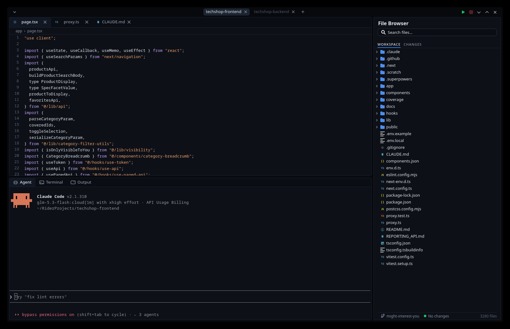
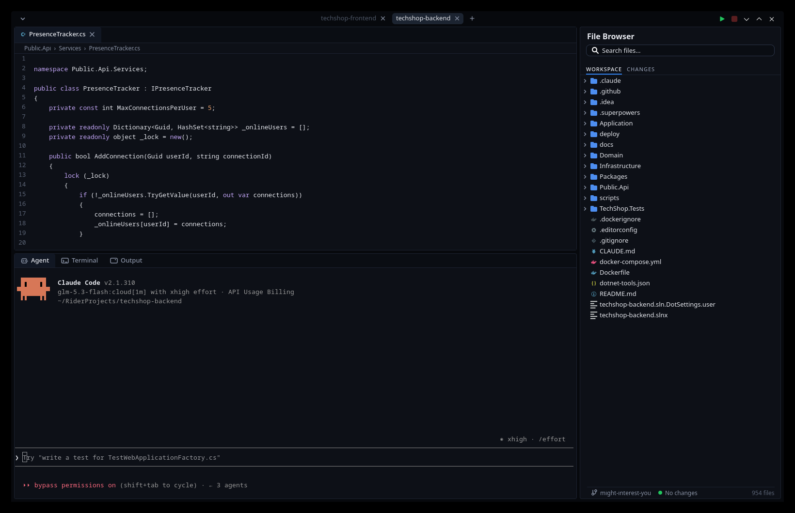
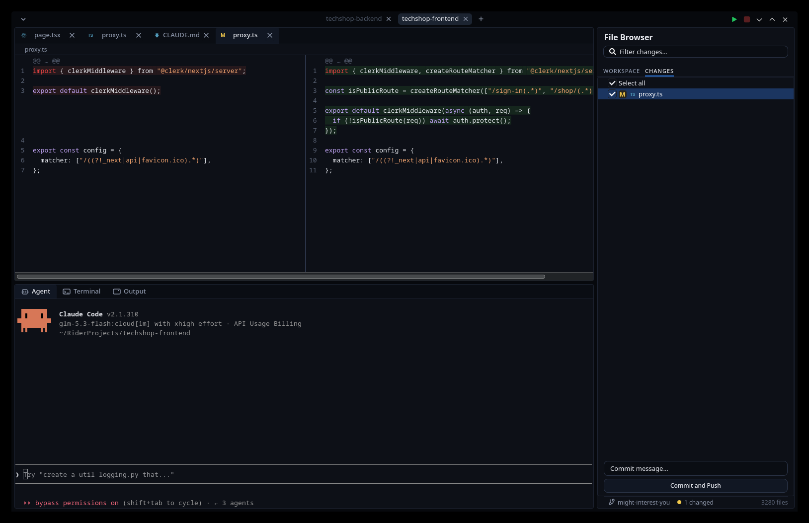
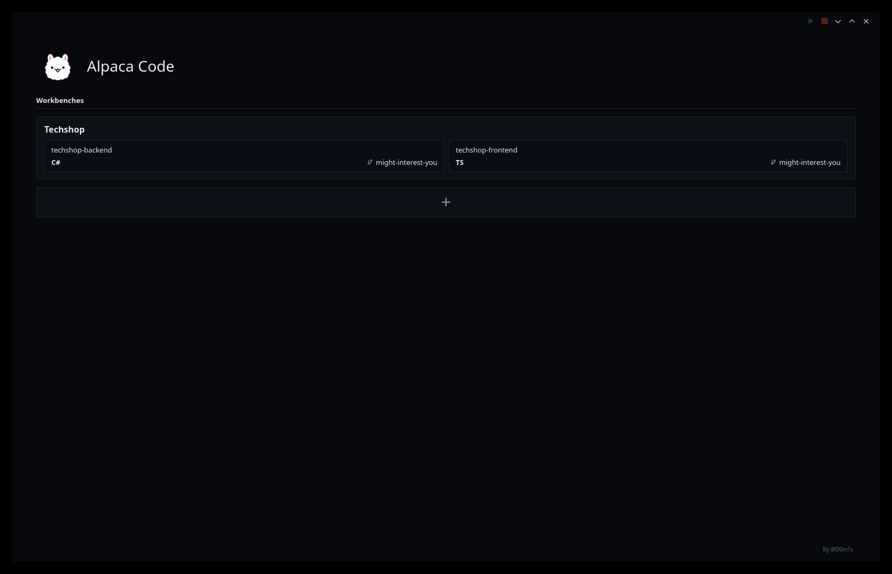

<p align="center">
  
</p>

<h1 align="center">Alpaca Code</h1>

<p align="center">
  A GTK4 desktop editor that puts the <strong>claude agent</strong> where your code lives.
  One dark window: a tabbed code editor, a file browser, and a console strip running the
  real <code>claude</code> TUI beside your terminal and your app's output.
</p>

<p align="center">
  <a href="https://github.com/D0m1s/alpaca-code/actions/workflows/ci.yml"></a>&nbsp;
  &nbsp;
  
</p>

<p align="center">
  
</p>

---

## Multiple projects, one window

The part you'll miss in every other editor: **two, even three projects live at the same
time** — each with its own editor tabs, its own file browser, its own git view, and its
own agent/terminal/output panes. Switch with the project pills in the header; whatever you
leave running (agents, builds, dev servers) keeps running while you're somewhere else.

<p align="center">
  
</p>

## Features

|  |  |
|---|---|
| **Agent console** | The raw `claude` TUI, spawned in your project root — not a watered-down chat widget. Ctrl+C inside it cancels claude's current action, not the pane; if claude exits, the pane revives it (capped, so a broken install can't respawn-loop). |
| **Editor** | Tabbed GtkSourceView with syntax highlighting (custom `alpaca-dark` scheme), per-tab breadcrumbs, dirty dots, Ctrl+S save, and side-by-side diff pages with cross-linked scrolling. Binary/NUL/non-UTF-8 files are refused at open so a save can never mangle them. |
| **Built-in git** | CHANGES view with select-to-commit and a commit bar, branch pill with Switch / Pull / New Branch, a `changed / branch / files` status row probing live every 2s — no third-party extension needed. |
| **Diff lenses** | Click a changed file in CHANGES to open a side-by-side tinted mono diff with number panes and cross-linked scroll. |
| **File browser** | Lazy tree (skips `node_modules`, `.git`, `obj`, `bin`, `vendor`), live file monitors, project-wide filename search, file count. |
| **Run & output** | `npm run dev` / `npm start` / `dotnet run` auto-detected from the project; one Stop kills the whole child tree. |
| **Terminal** | Your `$SHELL` as a real VTE terminal, with `~/.local/bin` on PATH even when launched from a menu. |
| **Workbenches** | Explicit save sessions: paned widths, scroll position, open tree folders — all persisted. Boot into the launcher and every saved workbench is a card with its project tiles, language badges, and git branches. |

<p align="center">
  
</p>

<p align="center">
  
</p>

## Download

Grab the latest prebuilt binary from
[**Releases**](https://github.com/D0m1s/alpaca-code/releases) — a single `x86_64-linux`
build, drop it on your `PATH` and run. It still needs the GTK stack from your system:

```sh
sudo pacman -S --needed gtksourceview5 vte4
```

## Build from source

Requirements: Linux, GTK 4.22+ (the app uses the `v4_22` API floor — current Arch,
CachyOS, and Fedora all qualify), GtkSourceView 5, VTE 4, and a Rust 2024 toolchain.

```sh
sudo pacman -S --needed gtksourceview5 vte4     # Arch/CachyOS system deps
git clone https://github.com/D0m1s/alpaca-code.git
cd alpaca-code
cargo build --release
cargo install --path .                          # or: cp target/release/alpaca-code-rs ~/.local/bin/
```

## Run

```sh
alpaca-code-rs                  # the workbench launcher hub
alpaca-code-rs ~/some/project   # boot straight into a project
```

## Shortcuts

| Key | Action |
|---|---|
| Ctrl+S | Save active tab |
| Ctrl+Shift+S | Save workbench |
| Ctrl+Shift+F | Focus the panel search |
| Ctrl+Q | Quit (tabs persist) |

## State

`~/.config/alpaca-code/state.json` — last project, recents, open workspaces, window geometry.
`~/.config/alpaca-code/workbenches/<uuid>.json` — one saved session layout each.
Everything loads forgivingly: a corrupt file coerces to defaults, never a broken startup.

## Development

```sh
cargo test    # 70 displayless unit tests — the gate every change must pass
cargo build   # cargo test does not refresh the runnable binary
./target/debug/alpaca-code-rs
```

CI runs `test`, `clippy -D warnings`, and `fmt` as hard gates on every push, plus weekly
RustSec audits. Pull requests welcome.

## License

Dual-licensed under your choice of [MIT](LICENSE-MIT) or [Apache-2.0](LICENSE-APACHE).